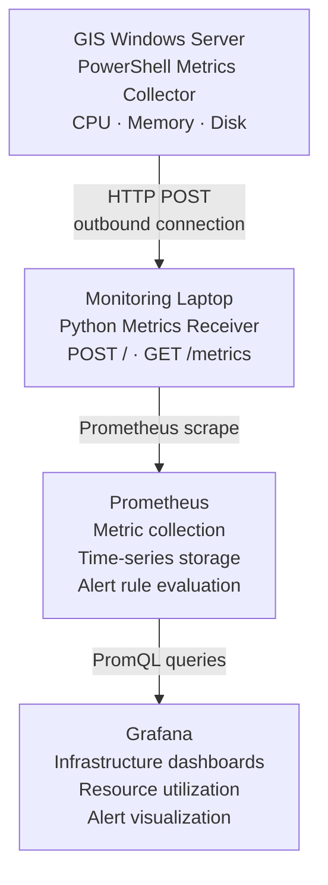

<div align="center">

# 📡 GIS Monitoring System

### Infrastructure Monitoring for GIS Servers Using Prometheus and Grafana


</div>

---

## 📑 Contents

[Overview](#1--overview) · [Tech Stack](#2--technology-stack) · [Architecture](#3--system-architecture) · [Repo Structure](#4--repository-structure) · [Metrics](#5--metrics-collected) · [Installation](#6--installation-and-configuration) · [Task Scheduler](#7--automate-collection-with-task-scheduler) · [Alerting](#8--alerting) · [Grafana](#9--grafana-dashboard) · [Troubleshooting](#10--validation-and-troubleshooting) · [Security](#11--security-and-operational-considerations) · [Limitations](#12--known-limitations) · [Roadmap](#13--roadmap) · [Outcome](#14--expected-outcome)

---

## 1. 🔭 Overview

The GIS Monitoring System provides centralized visibility into the health, resource utilization, and operational status of GIS infrastructure.

The initial implementation monitors Windows servers using a **custom PowerShell metrics collection script**, a **Python HTTP receiver**, **Prometheus** for time-series metric collection, and **Grafana** for visualization and alerting.

The system is designed to start as a local proof of concept (PoC) and evolve into a centralized monitoring platform for **three GIS servers** and the GIS web applications used by internal teams and external stakeholders.

### 🎯 Objectives

- Monitor CPU utilization, memory consumption, and disk usage across GIS servers.
- Collect metrics from servers where direct inbound monitoring connections may be restricted.
- Identify each server through consistent metric labels.
- Visualize infrastructure health through Grafana dashboards.
- Detect resource utilization issues using Prometheus alert rules.
- Establish a foundation for monitoring GIS applications, services, logs, and stakeholder usage.
- Provide an extensible and auditable monitoring solution.

## 2. 🧰 Technology Stack

| Component | Technology | Responsibility |
|---|---|---|
| Metrics collection | PowerShell | Collect Windows server metrics |
| Metrics transport | HTTP POST | Send collected metrics to the receiver |
| Metrics receiver | Python | Receive and expose metrics |
| Time-series database | Prometheus | Scrape and store metrics |
| Visualization | Grafana | Dashboards and alert visualization |
| Containerization | Docker Compose | Run Prometheus and Grafana |
| Automation | Windows Task Scheduler | Schedule periodic collection |

## 3. 🏗 System Architecture

The initial architecture uses a **push-to-pull bridge**: servers push metrics outbound to a receiver, and Prometheus then scrapes the receiver.



> [!WARNING]
> The current implementation uses **HTTP, not HTTPS**. The receiver binds to the laptop's network interfaces, so firewall rules and network access must be considered. The push approach avoids requiring Prometheus to initiate a connection to the GIS server, but it still requires the server to be allowed to reach the receiver.

## 4. 🗂 Repository Structure

The recommended project structure:

```text
GIS MONITORING/
│
├── docker-compose.yml
├── README.md
│
├── prometheus/
│   ├── prometheus.yml
│   └── alerts.yml
│
├── Metrics Receiver/
│   ├── receiver.py
│   └── received_metrics/
│       └── <server-address>.prom
│
└── Scripts/
    └── push_metrics.ps1
```

| Where it runs | What |
|---|---|
| **GIS server** | `push_metrics.ps1` (copy the script to the server) |
| **Monitoring machine (PoC)** | Python receiver, Prometheus, Grafana |

The `received_metrics` directory is optional if the receiver exposes the latest metrics directly from memory, as in the current implementation.

## 5. 📊 Metrics Collected

All three metrics are **gauges expressed as percentages between 0 and 100**. The `server` label identifies the originating server, while the `drive` label distinguishes individual volumes.

| Metric | Example | Description |
|---|---|---|
| `windows_cpu_usage` | `windows_cpu_usage{server="172.16.15.55"} 35` | Approximate CPU utilization percentage reported by Windows |
| `windows_memory_usage` | `windows_memory_usage{server="172.16.15.55"} 62.5` | Percentage of visible physical memory currently in use |
| `windows_disk_usage` | `windows_disk_usage{server="172.16.15.55",drive="C:"} 74.92` | Percentage of space used on each local fixed disk |

## 6. ⚙️ Installation and Configuration

### 6.1 Prerequisites

Install the following on the **monitoring laptop**:

- Docker Desktop with Docker Compose
- Python 3
- Visual Studio Code
- A web browser for accessing Prometheus and Grafana

The **GIS server** requires Windows PowerShell and permission to execute the collection script.

### 6.2 Start Prometheus and Grafana

From the project root:

```powershell
docker compose up -d
```

Verify that both containers are running:

```powershell
docker compose ps
```

Current host port mappings:

| Service | Local URL |
|---|---|
| Prometheus | http://localhost:9091 |
| Grafana | http://localhost:3041 |
| Python receiver | http://localhost:9443 |

Prometheus listens on port 9090 inside its container, while Grafana listens on port 3000 inside its container.

### 6.3 Prometheus Configuration

<details>
<summary><b>prometheus/prometheus.yml</b></summary>

```yaml
global:
  scrape_interval: 15s
  evaluation_interval: 15s

rule_files:
  - /etc/prometheus/alerts.yml

scrape_configs:
  - job_name: prometheus
    static_configs:
      - targets:
          - localhost:9090

  - job_name: pushed-windows-metrics
    metrics_path: /metrics
    static_configs:
      - targets:
          - host.docker.internal:9443
```

</details>

The receiver must be running and have received at least one metrics payload before useful server metric data appears.

<details>
<summary><b>docker-compose.yml</b> (mounts both configuration files into Prometheus)</summary>

```yaml
services:
  prometheus:
    image: prom/prometheus:latest
    container_name: prometheus
    volumes:
      - ./prometheus/prometheus.yml:/etc/prometheus/prometheus.yml:ro
      - ./prometheus/alerts.yml:/etc/prometheus/alerts.yml:ro
    ports:
      - "9091:9090"
    restart: unless-stopped

  grafana:
    image: grafana/grafana:latest
    container_name: grafana
    ports:
      - "3041:3000"
    volumes:
      - grafana-data:/var/lib/grafana
    restart: unless-stopped

volumes:
  grafana-data:
```

</details>

After modifying configuration files, validate and restart the stack:

```powershell
docker compose config
docker compose up -d
docker compose logs prometheus
```

### 6.4 Python Metrics Receiver

**File:** `Metrics Receiver/receiver.py`

The receiver accepts a POST request containing Prometheus-formatted text and makes the most recently received payload available through `GET /metrics`.

Run it from the monitoring laptop (it must remain running during the PoC):

```powershell
python "C:\GIS MONITORING\Metrics Receiver\receiver.py"
```

> [!CAUTION]
> **Current limitations:** The basic receiver uses plain HTTP, stores metrics in memory, and exposes the latest payload. It is **not a production-secure ingestion service**. If the receiver restarts, the in-memory payload is lost until the next successful push. Before production deployment, extend it with authentication, TLS, validation, bounded request sizes, and persistent storage.

### 6.5 PowerShell Metrics Collector

**File:** `Scripts/push_metrics.ps1`

The script runs on the GIS server and:

1. Retrieves CPU utilization.
2. Calculates memory utilization.
3. Calculates disk utilization for fixed local disks.
4. Formats the results in Prometheus exposition format.
5. Sends the payload to the monitoring laptop using HTTP POST.

Configure the destination using the monitoring laptop's reachable IP address:

```powershell
$receiver = "http://<MONITORING_LAPTOP_IP>:9443"
$serverId = "172.16.15.55"
```

> [!IMPORTANT]
> Use the actual IP address of the monitoring laptop. Do **not** use `localhost` in the server script, because that would refer to the GIS server itself.

The payload should include the `server` label on CPU and memory metrics, and both `server` and `drive` labels on disk metrics.

Run the script manually on the GIS server (the script must exist at that location first):

```powershell
powershell.exe -NoProfile -ExecutionPolicy Bypass -File "C:\GIS MONITORING\Scripts\push_metrics.ps1"
```

## 7. ⏱ Automate Collection with Task Scheduler

Configure Windows Task Scheduler on **each GIS server**.

1. Create a task named `GIS Monitoring Metrics Push`.
2. Set an appropriate service account with the necessary permissions.
3. Configure the trigger to repeat every minute.
4. Configure the action to start `powershell.exe`.
5. Set the arguments to:

   ```text
   -NoProfile -NonInteractive -File "C:\GIS MONITORING\Scripts\push_metrics.ps1"
   ```

6. Set the working directory to:

   ```text
   C:\GIS MONITORING\Scripts
   ```

7. Save the task and test it manually before relying on the schedule.

Configure the script to log failures and HTTP response errors. Ensure the monitoring laptop remains reachable and that the receiver process is running. The task interval and permissions should be reviewed with IT before deployment.

## 8. 🚨 Alerting

**File:** `prometheus/alerts.yml`

The following rules flag sustained high CPU utilization and disk utilization.

| Alert | Condition | Duration | Severity |
|---|---|---|---|
| `GISServerHighCPU` | CPU > 80% | 5 minutes | warning |
| `GISServerHighDiskUsage` | Disk > 85% | 10 minutes | critical |

<details>
<summary><b>alerts.yml</b></summary>

```yaml
groups:
  - name: gis-server-alerts
    rules:
      - alert: GISServerHighCPU
        expr: windows_cpu_usage > 80
        for: 5m
        labels:
          severity: warning
        annotations:
          summary: "High CPU utilization on {{ $labels.server }}"
          description: "CPU utilization has exceeded 80% for 5 minutes."

      - alert: GISServerHighDiskUsage
        expr: windows_disk_usage > 85
        for: 10m
        labels:
          severity: critical
        annotations:
          summary: "High disk utilization on {{ $labels.server }}"
          description: "Disk {{ $labels.drive }} has exceeded 85% utilization for 10 minutes."
```

</details>

After saving the rules, restart Prometheus and check the **Alerts** page.

> [!NOTE]
> These rules evaluate metric values, but they do **not** automatically send email or Microsoft Teams notifications. Notification delivery requires an alerting receiver, such as Alertmanager or Grafana-managed alerting, to be configured.

## 9. 📈 Grafana Dashboard

Open Grafana at http://localhost:3041 and add Prometheus as a data source using the internal Docker URL:

```text
http://prometheus:9090
```

Create a dashboard named **GIS Infrastructure Monitoring** with these recommended panels:

| Panel | PromQL query | Unit |
|---|---|---|
| CPU utilization | `windows_cpu_usage` | Percent (0–100) |
| Memory utilization | `windows_memory_usage` | Percent (0–100) |
| Disk utilization | `windows_disk_usage` | Percent (0–100) |
| CPU by server | `windows_cpu_usage` | Percent (0–100) |
| Disk by server and drive | `windows_disk_usage` | Percent (0–100) |

Use the `server` and `drive` labels in panel legends to distinguish servers and volumes:

```text
{{server}}
```

```text
{{server}} - {{drive}}
```

> [!TIP]
> Existing dashboards may require changes if they were originally designed for Linux `node_exporter`. Windows metrics use different names and labels.

## 10. 🔍 Validation and Troubleshooting

| Check | How |
|---|---|
| **Receiver is running** | Open `http://localhost:9443/metrics`. It should return the latest received metrics |
| **Server can reach the receiver** | From the GIS server run `Test-NetConnection <MONITORING_LAPTOP_IP> -Port 9443`. A successful TCP connection confirms basic connectivity, but not necessarily successful HTTP metric ingestion |
| **Prometheus is scraping** | Open `http://localhost:9091/targets`. The `pushed-windows-metrics` target should be `UP` |
| **Metrics are queryable** | Run `windows_cpu_usage`, `windows_memory_usage` and `windows_disk_usage` in Prometheus |

### Common problems

| Symptom | Possible cause |
|---|---|
| Receiver returns an empty response | No payload has been received since startup |
| HTTP connection fails | Incorrect IP, receiver stopped, or firewall restrictions |
| Prometheus target is DOWN | Receiver endpoint is unreachable or returns an error |
| Grafana panels show N/A | Incorrect metric names, labels, or dashboard variables |
| Alerts do not fire | Threshold not exceeded for the configured duration, or metrics are missing |
| Values stop updating | Scheduled task stopped, push failed, or receiver is unreachable |

## 11. 🔐 Security and Operational Considerations

> [!WARNING]
> The initial implementation is a proof of concept and should **not** be considered production-ready. The receiver should not be exposed directly to the public internet.

Before production use:

- [ ] Use HTTPS with certificate validation
- [ ] Authenticate and authorize metric submissions
- [ ] Restrict inbound receiver access to approved source addresses
- [ ] Avoid exposing the receiver to untrusted networks
- [ ] Confirm which telemetry may be collected under organizational policy
- [ ] Keep logs free of credentials and other sensitive data
- [ ] Run the receiver under a least-privilege account
- [ ] Add monitoring for stale metrics and failed submissions
- [ ] Configure persistent Prometheus storage and backups
- [ ] Pin container image versions and review updates
- [ ] Obtain IT approval for network paths, service accounts, and scheduled tasks

## 12. 🚧 Known Limitations

The initial PoC currently collects only CPU, memory, and disk utilization. It does **not** yet provide:

- Historical persistence of pushed metrics inside the receiver itself
- Reliable per-server heartbeat and stale-data detection
- Network throughput metrics
- ArcGIS Server or IIS service health
- GIS web application request counts or response times
- Authentication and audit logs
- Notification delivery for alert rules
- High availability for the monitoring stack

The in-memory receiver only retains the latest payload. Prometheus stores samples as it scrapes them, so successful repeated scraping is necessary to build historical time-series data.

## 13. 🗺 Roadmap

### Phase 1 · Infrastructure PoC

- [x] Deploy Prometheus and Grafana using Docker Compose
- [x] Implement a Python metrics receiver
- [x] Collect CPU, memory, and disk metrics using PowerShell
- [x] Push metrics from a Windows server to the monitoring laptop
- [ ] Add and validate server identity labels
- [ ] Automate collection using Task Scheduler
- [ ] Validate Prometheus alert rules
- [ ] Build the GIS infrastructure dashboard

### Phase 2 · Multi-Server Monitoring

- [ ] Add the remaining two GIS servers
- [ ] Standardize server identifiers and labels
- [ ] Add network metrics and service health checks
- [ ] Add freshness checks and monitoring of collection failures

### Phase 3 · GIS Application Monitoring

- [ ] Collect IIS and GIS application access logs
- [ ] Measure requests, response times, and HTTP errors
- [ ] Monitor ArcGIS services and application availability
- [ ] Measure usage by application and endpoint while respecting privacy and access controls

### Phase 4 · Production Hardening

- [ ] Deploy on an approved monitoring VM or server
- [ ] Implement TLS and authentication
- [ ] Configure notification delivery and incident escalation
- [ ] Establish retention, backup, access control, and operational procedures

## 14. 🏁 Expected Outcome

The completed system will provide the GIS section with a centralized view of infrastructure health, resource utilization, and emerging capacity problems.

The initial PoC establishes the collection and visualization foundation. Further work will extend the platform to the three GIS servers, GIS web applications, logs, stakeholder usage, and production-grade alerting.

---

<div align="center">

**Project status:** Proof of concept. Initial Windows server metric ingestion and visualization pipeline under development.

</div>
